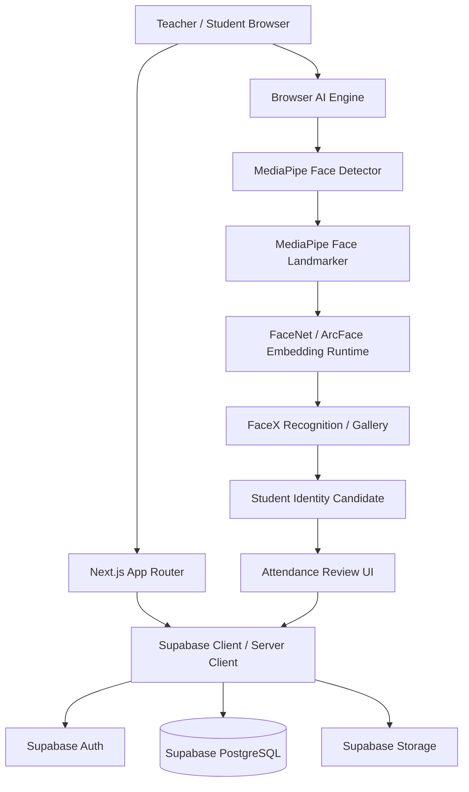
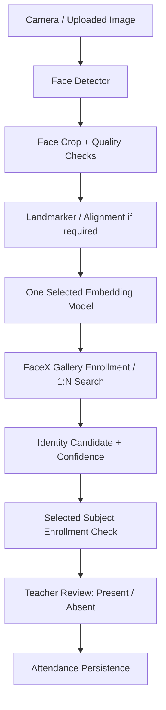

# Haziri.AI — Architecture & Migration Specification

> Status: Target architecture  
> Repository: https://github.com/alokprasad573/Haziri.AI  
> Constraint: No separately operated custom backend. Next.js + Supabase + browser AI.  
> Compatibility: Preserve current feature and data behavior. Replace dlib recognition; legacy descriptors are incompatible with the new model.

## 1. Architecture overview

Haziri.AI becomes a browser-first Next.js application backed by Supabase. Next.js provides routes, UI, session-aware operations, and typed Supabase integration. Browser code performs face detection, landmarks, embedding inference, and recognition using the AI stack that passes the compatibility spike.

There is no separately deployed FastAPI or Express service.

Supabase provides PostgreSQL, Auth, Storage only where persistence is required, and RLS. Browser AI creates recognition candidates; Supabase policies independently constrain data access and attendance writes.

## 2. Agreed stack

| Component | Technology |
|---|---|
| Framework | Next.js (App Router) |
| Language | TypeScript |
| Styling | Tailwind CSS |
| UI Components | shadcn/ui |
| Face Detection | MediaPipe Face Detector |
| Face Landmarks | MediaPipe Face Landmarker |
| Face Embeddings | Browser-compatible FaceNet / ArcFace |
| Face Recognition | FaceX |
| Animations | Framer Motion |
| Database | Supabase PostgreSQL |
| Authentication | Supabase Auth |
| Storage | Supabase Storage |
| Deployment | Vercel |

Supporting packages may include `@supabase/ssr`, `@supabase/supabase-js`, `@mediapipe/tasks-vision`, ONNX Runtime Web if required by the chosen model, React Hook Form, Zod, TanStack Query, and Lucide React.

## 3. Logical architecture



This is a target responsibility map, not proof of direct library interoperability. Section 6 defines a mandatory spike to determine detection ownership, landmark necessity, embedding model ownership, and FaceX gallery compatibility. Avoid duplicate detectors/embedders.

## 4. Runtime and trust boundaries

### 4.1 Browser — untrusted client
Responsibilities:
- Render client-side UI and dashboards.
- Request camera permission and capture images.
- Load AI assets lazily.
- Run detection, landmarks, embedding, and recognition.
- Maintain temporary photo previews and pending attendance report.
- Submit typed requests through authenticated Supabase client.

Treat all browser-provided teacher/student/subject IDs, model confidence, recognition labels, URL query params, and attendance data as untrusted. RLS must enforce actual authorization.

### 4.2 Next.js server runtime
Responsibilities:
- Render page shells and protected server-side reads where appropriate.
- Read/refresh Supabase sessions using secure cookies and official SSR client integration.
- Validate actor/session/role for sensitive mutations.
- Host thin Route Handlers or Server Actions only when a trusted server boundary is required and can remain within the Next.js application.

Restrictions:
- Never expose service-role key to client.
- Do not create a second business logic service.
- Do not proxy large camera streams needlessly.
- Do not execute dlib, Python, or face inference inside Vercel Edge/serverless.
- Use Web Workers for expensive browser inference when supported.

### 4.3 Supabase
Responsibilities:
- Persist business records and Auth identity.
- Enforce row-level access.
- Store model-versioned biometric templates, using a reviewed representation.
- Store images only when an explicit product requirement needs persistence.

RLS is the data security boundary. Browser calls using publishable/anon key are acceptable only after policies are proven. A server secret is not a substitute for correct policies.

## 5. Existing domain model and data-access mapping

The current repository references tables:
- `teachers`
- `students`
- `subjects`
- `subject_students`
- `attendance_logs`

Inspect live schema, primary/foreign keys, unique constraints, grants, and current RLS before creating migrations.

| Existing function in `src/databases/db.py` | Behavior to preserve | Target service |
|---|---|---|
| `check_duplicates` | Check ID/email/mobile | Typed registration validation plus database uniqueness |
| `create_teacher_account` | Store teacher profile and bcrypt hash | Supabase Auth identity + linked profile |
| `teacher_login` | Teacher ID lookup and bcrypt verify | Secure Auth account-linking flow; never verify hash in browser |
| `get_all_students` | Fetch students for recognition gallery | Authorized/minimized model template gallery |
| `create_student_account` | Create student profile and face embedding | Auth identity + student profile + versioned new template |
| `create_subject_now` | Insert teacher-owned subject | Insert subject for authenticated teacher |
| `get_all_subjects_by_teacher` | List teacher subjects with counts | RLS-constrained query preserving aggregates |
| `get_subject_id` | Resolve subject code | Safe subject-code lookup |
| `is_student_enrolled` | Check relationship | Enrollment query |
| `enroll_in_subject` | Insert if absent | Idempotent enrollment |
| `unenroll_student_to_subject` | Delete relationship | Student-owned deletion |
| `get_enrolled_subjects` | Student subject list | Current-student query |
| `get_student_attendance` | Attendance with subjects | Current-student attendance query |
| `take_attendance` | Insert attendance logs | Validated, authorized attendance mutation |
| `check_attendance` | Check student/subject attendance | Compatible query |
| `get_attendance_records` | Attendance for teacher-owned subjects | Teacher-scoped attendance query |

Never trust a client-provided `teacher_id` or `student_id` as the actor. Derive the actor from the session and use RLS.

### 5.1 Schema compatibility rules
- Do not rename or drop current tables/columns.
- Keep Teacher ID and Student ID stable.
- Preserve subject/enrollment relationships and historical attendance rows.
- Current teacher passwords are bcrypt hashes in `teachers`; they are not automatically Supabase Auth users.
- Current student face vectors are dlib 128D descriptors and are incompatible with FaceNet/ArcFace vectors.
- Keep legacy vectors untouched until approved retention/deletion decision.
- New embeddings must record model ID/version and dimension. If current column cannot represent this safely, propose a minimal additive change and get approval.
- Re-enrollment is required before old students can use new-model face login/attendance.
- Any auth migration must preserve IDs, ownership, and UX.

## 6. AI runtime architecture and mandatory compatibility gate

### 6.1 Responsibility separation
- **MediaPipe Face Detector:** bounding boxes/face detection; no identity.
- **MediaPipe Face Landmarker:** landmarks/blendshape outputs; no identity embedding.
- **FaceNet/ArcFace:** identity embedding generation from correctly preprocessed face crop.
- **FaceX:** proposed recognition/gallery layer; its package API and compatibility must be verified.
- **Supabase:** stores model-versioned templates and records; does not run inference.

### 6.2 Intended model flow



If FaceX bundles its own embedding model, that may be the single embedder. If FaceX accepts external vectors, verify its exact preprocessing/dimension/normalization contract. Never generate FaceNet vectors and pass them into FaceX without explicit support.

### 6.3 Compatibility spike exit criteria
- Pin exact package, version, repository, model artifact, and license.
- Confirm browser/WASM/WebGL/WebGPU runtime and supported browsers.
- Confirm input shape, color order, normalization, alignment, output dimension, vector normalization.
- Prove FaceX 1:N gallery identification across enrolled student IDs.
- Prove multi-face-per-image output mapping.
- Prove unknown-face rejection and confidence calibration.
- Measure mid-range mobile and desktop performance.
- Confirm model assets can be legally hosted and loaded from Vercel.
- Add fixtures for known, unknown, multiple, low-quality, and empty-gallery cases.

**Stop condition:** If FaceX cannot perform browser-based 1:N student gallery search using the selected embedding model, report incompatibility and request an explicit stack decision. Do not silently add custom KNN/distance code or swap the agreed library.

### 6.4 Biometric migration and threshold
- Existing dlib descriptor size is 128D with old Euclidean threshold `0.6`.
- New embedding dimension/distribution/normalization may differ.
- Old threshold is not transferable.
- Calibrate new model using consented representative data across lighting, pose, distance, occlusion, and camera quality.
- Measure false accept/reject rates.
- Legacy-only students must re-enroll.
- Apply an approved biometric consent, retention, deletion, and migration plan.

## 7. Authentication architecture

Current code uses:
- Teacher profile/password stored in `teachers`, with bcrypt hashing and verification.
- Student profile + face embedding registration; face-based login.
- Custom business IDs generated in `T####` and `S####` formats.

Supabase Auth is not automatically compatible with that custom auth.

### 7.1 Target requirements
- Supabase Auth issues the authenticated session.
- Link `auth.users.id` to teacher/student profile via reviewed additive linkage or existing safe relationship.
- Preserve business-facing Teacher ID and Student ID.
- Preserve Teacher ID + password UX via secure server-mediated lookup/linking. Never send bcrypt hash to browser or verify password client-side.
- Face login identifies a candidate, then establishes a real authenticated Supabase session using a secure proof-of-identity flow. Client must not request a session for arbitrary `student_id`.
- Define account recovery and initial migration for existing bcrypt accounts.
- Never overwrite account hashes or delete profiles in an untested migration.

### 7.2 Session handling
- Use `@supabase/ssr` and current official Next.js guidance.
- HttpOnly, Secure-in-production, SameSite cookie handling.
- Validate sessions in protected Server Components and Route Handlers.
- RLS remains definitive data boundary.
- Logout clears Supabase session.
- If face-only login cannot safely establish Supabase Auth session without trusted verification, treat it as a blocker rather than trusting browser identity assertions.

## 8. Proposed frontend directory structure

Keep current Streamlit app runnable while the Next.js app is built in a separate `frontend/` directory.

```text
Haziri.AI/
├── frontend/
│   ├── src/
│   │   ├── app/
│   │   │   ├── (public)/page.tsx
│   │   │   ├── (auth)/
│   │   │   │   ├── teacher/login/page.tsx
│   │   │   │   ├── teacher/register/page.tsx
│   │   │   │   ├── student/login/page.tsx
│   │   │   │   └── student/register/page.tsx
│   │   │   ├── teacher/dashboard/
│   │   │   │   ├── page.tsx
│   │   │   │   ├── subjects/page.tsx
│   │   │   │   ├── attendance/page.tsx
│   │   │   │   └── records/page.tsx
│   │   │   ├── student/dashboard/
│   │   │   │   ├── page.tsx
│   │   │   │   ├── subjects/page.tsx
│   │   │   │   └── attendance/page.tsx
│   │   │   ├── auth/callback/route.ts
│   │   │   ├── layout.tsx
│   │   │   └── globals.css
│   │   ├── components/
│   │   │   ├── ui/
│   │   │   ├── layout/
│   │   │   ├── auth/
│   │   │   ├── teacher/
│   │   │   ├── student/
│   │   │   ├── subjects/
│   │   │   └── attendance/
│   │   ├── features/
│   │   │   ├── face-recognition/
│   │   │   │   ├── engine/
│   │   │   │   ├── enrollment/
│   │   │   │   ├── identification/
│   │   │   │   └── types/
│   │   │   ├── attendance/
│   │   │   ├── authentication/
│   │   │   └── subjects/
│   │   ├── lib/
│   │   │   ├── supabase/
│   │   │   ├── validations/
│   │   │   └── utils/
│   │   ├── services/
│   │   ├── hooks/
│   │   └── types/
│   ├── public/models/ (only licensed assets)
│   ├── package.json
│   └── tsconfig.json
├── src/                  # Existing Python app retained during migration
├── static/               # Reuse existing assets
├── requirements.txt      # Retain until cutover
├── PRD.md
└── ARCHITECTURE.md
```

Adjust routes only if necessary for coherent UX; preserve feature boundaries and role separation.

## 9. Client/server component boundaries
- Server Components: page shells, metadata, authenticated reads, role-aware navigation.
- Client Components: camera, file input, MediaPipe runtime, inference, Framer Motion, dialogs, interactive tabs, previews.
- Dynamically import browser-only AI modules; do not access `window`, `navigator`, camera, WebGL, or WASM during SSR.
- Use Web Workers for expensive inference when supported.
- Cache model initialization safely per browser session.
- Dispose model resources and stop camera tracks on unmount/route change/cancel.
- Respect `prefers-reduced-motion`.

## 10. Module boundaries

### 10.1 Supabase integration
- `lib/supabase/client.ts`: browser client.
- `lib/supabase/server.ts`: cookie-aware server client.
- Session refresh integration using current Next.js/Supabase recommendations.
- Typed services: teachers, students, subjects, attendance.
- Authorization remains in RLS and server session checks.

### 10.2 Face recognition abstraction

Use an application adapter so UI is not coupled to vendor-specific API:

```ts
export interface FaceRecognitionEngine {
  initialize(): Promise<void>;
  detectFaces(image: ImageData | HTMLImageElement | HTMLVideoElement): Promise<DetectedFace[]>;
  createEnrollmentTemplate(face: DetectedFace): Promise<EnrollmentTemplate>;
  identifyFaces(faces: DetectedFace[], gallery: RecognitionGallery): Promise<IdentificationResult[]>;
  dispose(): Promise<void>;
}

export interface EnrollmentTemplate {
  modelId: string;
  modelVersion: string;
  embeddingDimension: number;
  vector: number[];
}

export interface IdentificationResult {
  faceIndex: number;
  studentId: string | null;
  confidence: number | null;
  accepted: boolean;
  reason?: "unknown" | "low_quality" | "ambiguous";
}
```

This is an application contract, not a claim that FaceX currently exposes these exact methods. Implement the adapter only after inspecting the pinned FaceX API. Failure to satisfy the contract is a spike failure.

### 10.3 Attendance use case
1. Capture camera image or files.
2. Load enrolled student list and authorized template gallery.
3. Analyze every image.
4. Attribute accepted identity candidates to source photo indexes.
5. Intersect identities with subject enrollment.
6. Aggregate one row per enrolled student; Present if recognized in one or more photos, otherwise Absent.
7. Show teacher a review table.
8. Discard without DB writes, or confirm and persist.
9. Clear pending images only after successful save or explicit discard.

## 11. Attendance data flow

```mermaid
sequenceDiagram
    actor Teacher
    participant UI as Next.js Attendance UI
    participant AI as Browser AI Engine
    participant DB as Supabase

    Teacher->>UI: Select owned subject
    UI->>DB: Load subject enrollments and allowed templates
    DB-->>UI: Enrolled roster
    Teacher->>UI: Capture/upload multiple photos
    UI->>AI: Analyze each image
    AI-->>UI: Per-face identity candidates + photo index
    UI->>UI: Restrict to enrolled IDs; aggregate once per student
    UI-->>Teacher: Review Present/Absent + source photo
    alt Discard
        Teacher->>UI: Discard
        UI->>UI: Clear pending state; no DB write
    else Confirm
        Teacher->>UI: Confirm & Save
        UI->>DB: Authorized attendance insert
        DB-->>UI: Save result
        UI-->>Teacher: Success; clear pending photos
    end
```

Prefer gallery scoped to selected subject to minimize biometric exposure. If a broader gallery is required, apply strict enrollment membership before review/persistence and rely on RLS to prevent cross-owner access.

## 12. Authorization matrix

| Action | Teacher | Student | Unauthenticated |
|---|---:|---:|---:|
| View public home | Allow | Allow | Allow |
| View teacher dashboard | Own only | Deny | Deny |
| View student dashboard | Deny | Own only | Deny |
| Create/list subjects | Own teacher identity | Deny | Deny |
| View minimal join metadata | As needed | As needed | Minimal only |
| Enroll student | Deny | Own identity only | Deny |
| Unenroll | Deny | Own enrollment only | Deny |
| Run attendance analysis | Own subject | Deny | Deny |
| Save attendance | Own subject | Deny | Deny |
| View teacher records | Own subjects | Deny | Deny |
| View student attendance | Deny | Own records | Deny |

RLS tests must prove allowed and denied cases. Route guards alone are insufficient.

## 13. Error handling

Explicit UI handling:
- Session expired/refresh failure.
- RLS permission denied.
- Subject missing, no subjects, no enrolled students.
- Duplicate registration/enrollment.
- Camera unsupported/denied/unavailable.
- Invalid image type/size.
- No face/multiple faces in single-face enrollment/low quality/unknown/ambiguous face.
- Model asset or initialization failure.
- Unsupported inference backend.
- Multi-photo partial analysis failure.
- Attendance write timeout/failure.
- Repeated confirm click or stale session.

Never log raw images, embeddings, passwords, or tokens.

## 14. Testing architecture

### Unit tests
- ID and form validation.
- Join-code parsing.
- Subject/attendance aggregation.
- Multi-photo duplicate recognition.
- Present/Absent calculation.
- Model version/dimension validation.
- AI adapter mapping with mocked vendor API.

### Integration tests
- Supabase Auth session lifecycle and profile mapping.
- RLS teacher/student isolation.
- Subject creation and enrollment.
- Attendance review, discard, confirm/save.
- Idempotency/double submit.
- Historical record compatibility.

### AI evaluation
- Known/unknown face.
- Multiple students in one image.
- Same student in several images.
- Lighting, pose, distance, occlusion.
- Low resolution, crop boundaries.
- Empty gallery/no face.
- Re-enrollment version validation.
- FAR/FRR threshold evaluation.

### E2E
- Teacher registration/login/dashboard/logout.
- Student registration/face enrollment/login/dashboard/logout.
- Create subject, QR share, open join URL, enrollment.
- Upload/capture multiple classroom images.
- Review/discard/save attendance.
- Manual override.
- Teacher records/export.
- Student attendance history.
- Unauthorized cross-role/cross-owner attempts.

## 15. Deployment and environment

Deploy Next.js to Vercel; Supabase remains a managed external service.

Public variables (use exact current Supabase naming):
- `NEXT_PUBLIC_SUPABASE_URL`
- `NEXT_PUBLIC_SUPABASE_ANON_KEY` or current publishable-key equivalent.

Any required privileged secret:
- `SUPABASE_SERVICE_ROLE_KEY` (server-only, never prefixed NEXT_PUBLIC; avoid where RLS suffices).

Model artifacts:
- Pin model version and checksum.
- Host only when license permits redistribution.
- Configure CORS/cache.
- Lazy-load only on AI routes.
- Document fallback when browser inference unsupported.

Use isolated local/preview/test data. Never run destructive tests/migrations against production.

## 16. Migration and rollback

1. Audit complete app and capture behavior baseline.
2. Inspect Supabase schema/constraints/RLS.
3. Run MediaPipe + embedding + FaceX compatibility spike.
4. Resolve Supabase Auth migration for bcrypt teachers and face-login students.
5. Build Next.js alongside Streamlit.
6. Port modules with feature parity tests.
7. Migrate face enrollment/re-enrollment with model version.
8. Verify attendance and reports against baseline.
9. Deploy Vercel preview and run acceptance suite.
10. Cut over only after sign-off.
11. Keep Streamlit app/deployment and data rollback path until stabilization.

Do not delete Python modules or Streamlit/dlib dependencies early. Remove only after cutover and separate cleanup review.

## 17. Architecture decision log

| Decision | Position | Status |
|---|---|---|
| Frontend | Next.js App Router + TypeScript | Agreed |
| Styling/UI | Tailwind + shadcn/ui | Agreed |
| Animation | Framer Motion | Agreed |
| Database | Existing Supabase PostgreSQL | Agreed |
| Auth | Supabase Auth | Target agreed; legacy account migration unresolved |
| Storage | Supabase Storage | Agreed; use only when needed |
| Detection | MediaPipe Face Detector | Candidate; overlap with FaceX to verify |
| Landmarks | MediaPipe Face Landmarker | Candidate; necessity to verify |
| Embedding | Browser FaceNet/ArcFace | Model family agreed; artifact unresolved |
| Recognition | FaceX | Candidate agreed; 1:N and vector compatibility unresolved |
| Custom backend | None | Agreed |
| Legacy dlib vectors | Do not reuse; re-enroll | Required |
| Existing schema | Preserve; additive change only after review | Required |

## 18. Risks and blockers

1. MediaPipe/FaceX may duplicate detection responsibilities.
2. FaceX may not provide in-browser 1:N gallery identification.
3. Existing bcrypt teacher accounts are not Supabase Auth users.
4. Client-side face matching alone cannot safely mint a Supabase session for arbitrary student identity.
5. Existing dlib vectors are incompatible; students need re-enrollment.
6. Some privileged identity operations or transactional writes may need thin Next.js Route Handlers. This is not a separately operated backend. If no secure RLS/browser design exists, treat as blocker.
7. Current schema may lack auth user mapping, template versioning, RLS, uniqueness, or idempotency support.
8. Multi-photo, multi-face inference can be expensive on mobile; benchmark without removing capabilities.

**Release rule:** Do not claim parity until blockers have documented evidence-based resolutions and all PRD acceptance criteria pass.