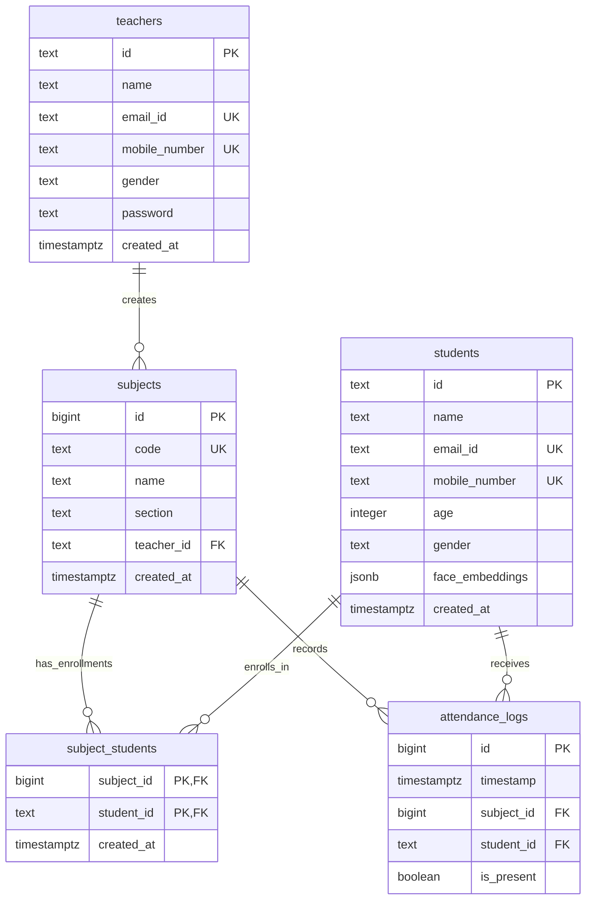

# Haziri.AI — Database Setup & Schema

> Repository: https://github.com/alokprasad573/Haziri.AI  
> Database: Supabase PostgreSQL  
> Status: Migration reference  
>
> **Important:** The schema below is provided for context and documentation. It is not a migration script and is not guaranteed to execute as-is. Verify the live Supabase schema, table order, constraints, indexes, grants, and Row Level Security (RLS) policies before applying any database changes.

## 1. Supabase client setup

### 1.1 Install the Supabase package

Run this command from the Next.js application's directory:

```bash
npm install @supabase/supabase-js
```

### 1.2 Add Supabase Library blocks

Install the Supabase Library blocks through the shadcn registry:

```bash
npx shadcn@latest add @supabase/supabase-client-nextjs
```

The Supabase Library provides reusable building blocks for authentication, realtime, storage, and related Supabase workflows. Browse the available blocks at [supabase.com/library](https://supabase.com/library).

> Review the registry component's generated files and dependencies before adopting them. These blocks complement the Supabase SDK; they do not replace server-side session validation or database RLS.

### 1.3 Configure environment variables

Create `.env.local` in the Next.js application root:

**File: `.env.local`**

```dotenv
NEXT_PUBLIC_SUPABASE_URL=
NEXT_PUBLIC_SUPABASE_PUBLISHABLE_KEY=
```

Fill in the values from the Supabase project's API settings.

- `NEXT_PUBLIC_SUPABASE_URL`: Supabase project URL.
- `NEXT_PUBLIC_SUPABASE_PUBLISHABLE_KEY`: Supabase publishable key.

Do not commit `.env.local` to Git. Ensure it is included in `.gitignore`.

**Security rules:**
- The publishable key is intended for use in the browser. It does not bypass RLS.
- Never expose the Supabase service-role key through a `NEXT_PUBLIC_*` variable or client-side code.
- If a privileged server operation is genuinely required, keep its secret in server-only environment configuration and authorize the operation on the server.
- Enable and test RLS for every table containing user- or role-scoped data before production use.

### 1.4 Install Agent Skills (optional)

Agent Skills provide AI coding tools with instructions, scripts, and resources for working with Supabase.

```bash
npx skills add supabase/agent-skills
```

This step is optional and does not affect application runtime or database connectivity.

---

## 2. Database overview

The current application data model references five public tables:

| Table | Responsibility | Primary key |
|---|---|---|
| `teachers` | Teacher profile and legacy credential data | `id` (text) |
| `students` | Student profile and face embedding data | `id` (text) |
| `subjects` | Subjects created and owned by teachers | `id` (bigint identity) |
| `subject_students` | Many-to-many student/subject enrollment | `subject_id, student_id` |
| `attendance_logs` | Per-student attendance records | `id` (bigint identity) |

### 2.1 Entity relationship diagram



### 2.2 Relationship rules

- One teacher can create multiple subjects.
- Each subject references its owning teacher through `subjects.teacher_id`.
- Students and subjects have a many-to-many relationship through `subject_students`.
- The composite primary key `(subject_id, student_id)` prevents duplicate enrollment rows for the same student and subject.
- Each attendance log references one subject and one student.
- Attendance status is represented by `attendance_logs.is_present`.

---

## 3. Existing schema reference (context only)

**WARNING: This schema is for context only and is not meant to be run. Table order and constraints may not be valid for execution.**

The following definitions document the schema supplied for the current project. They are not an approved migration. Do not paste this entire block into the Supabase SQL Editor without first comparing it with the live database.

```sql
CREATE TABLE public.teachers (
    id text NOT NULL,
    name text NOT NULL,
    email_id text NOT NULL UNIQUE,
    mobile_number text NOT NULL UNIQUE,
    gender text NOT NULL,
    password text NOT NULL,
    created_at timestamp with time zone DEFAULT now(),
    CONSTRAINT teachers_pkey PRIMARY KEY (id)
);

CREATE TABLE public.students (
    id text NOT NULL,
    name text NOT NULL,
    email_id text NOT NULL UNIQUE,
    mobile_number text NOT NULL UNIQUE,
    age integer NOT NULL,
    gender text NOT NULL,
    face_embeddings jsonb NOT NULL,
    created_at timestamp with time zone DEFAULT now(),
    CONSTRAINT students_pkey PRIMARY KEY (id)
);

CREATE TABLE public.subjects (
    id bigint GENERATED ALWAYS AS IDENTITY NOT NULL,
    code text NOT NULL UNIQUE,
    name text NOT NULL DEFAULT 'unknown'::text,
    section text NOT NULL DEFAULT 'N/A'::text,
    teacher_id text,
    created_at timestamp with time zone DEFAULT now(),
    CONSTRAINT subjects_pkey PRIMARY KEY (id),
    CONSTRAINT subjects_teacher_id_fkey
        FOREIGN KEY (teacher_id) REFERENCES public.teachers(id)
);

CREATE TABLE public.subject_students (
    subject_id bigint NOT NULL,
    student_id text NOT NULL,
    created_at timestamp with time zone,
    CONSTRAINT subject_students_pkey PRIMARY KEY (subject_id, student_id),
    CONSTRAINT subject_students_subject_id_fkey
        FOREIGN KEY (subject_id) REFERENCES public.subjects(id),
    CONSTRAINT subject_students_student_id_fkey
        FOREIGN KEY (student_id) REFERENCES public.students(id)
);

CREATE TABLE public.attendance_logs (
    id bigint GENERATED ALWAYS AS IDENTITY NOT NULL,
    timestamp timestamp with time zone DEFAULT now(),
    subject_id bigint,
    student_id text,
    is_present boolean DEFAULT true,
    CONSTRAINT attendance_logs_pkey PRIMARY KEY (id),
    CONSTRAINT attendance_logs_subject_id_fkey
        FOREIGN KEY (subject_id) REFERENCES public.subjects(id),
    CONSTRAINT attendance_logs_student_id_fkey
        FOREIGN KEY (student_id) REFERENCES public.students(id)
);
```

---

## 4. Column and data notes

### 4.1 `teachers`

| Column | Type | Meaning |
|---|---|---|
| `id` | `text` | Application-generated Teacher ID |
| `name` | `text` | Teacher's name |
| `email_id` | `text` | Unique email address |
| `mobile_number` | `text` | Unique mobile number |
| `gender` | `text` | Existing gender value |
| `password` | `text` | Legacy password hash field; never return to client |
| `created_at` | `timestamptz` | Account creation time |

The current schema stores a password field in the teacher profile table. The migration target is Supabase Auth. Existing bcrypt hashes are not automatically Supabase Auth credentials: design and test a secure account-linking or migration flow before cutover. Never fetch or verify password hashes in browser code.

### 4.2 `students`

| Column | Type | Meaning |
|---|---|---|
| `id` | `text` | Application-generated Student ID |
| `name` | `text` | Student's name |
| `email_id` | `text` | Unique email address |
| `mobile_number` | `text` | Unique mobile number |
| `age` | `integer` | Student age |
| `gender` | `text` | Existing gender value |
| `face_embeddings` | `jsonb` | Legacy face descriptor/template data |
| `created_at` | `timestamptz` | Account creation time |

**Biometric compatibility warning:** Existing face embeddings were generated by the legacy dlib pipeline. They must not be compared with FaceNet/ArcFace embeddings. Treat legacy values as incompatible until a reviewed re-enrollment and retention plan is completed. New templates must be versioned with model identifier, model version, and embedding dimension; propose only reviewed additive schema changes if the current JSON representation is insufficient.

### 4.3 `subjects`

| Column | Type | Meaning |
|---|---|---|
| `id` | `bigint identity` | Database-generated subject key |
| `code` | `text` | Unique subject join code |
| `name` | `text` | Subject name |
| `section` | `text` | Subject section |
| `teacher_id` | `text` | Owning teacher ID |
| `created_at` | `timestamptz` | Creation time |

Preserve existing application normalization rules: subject name is stored lowercase and section uppercase, unless a separately approved product change says otherwise.

### 4.4 `subject_students`

| Column | Type | Meaning |
|---|---|---|
| `subject_id` | `bigint` | Enrolled subject |
| `student_id` | `text` | Enrolled student |
| `created_at` | `timestamptz` | Enrollment time |

The composite primary key prevents duplicate enrollment for a given subject/student pair.

### 4.5 `attendance_logs`

| Column | Type | Meaning |
|---|---|---|
| `id` | `bigint identity` | Attendance row ID |
| `timestamp` | `timestamptz` | Attendance timestamp |
| `subject_id` | `bigint` | Subject for this attendance row |
| `student_id` | `text` | Student for this attendance row |
| `is_present` | `boolean` | Present/Absent state |

The supplied schema does not define a session identifier or a uniqueness constraint for one student per subject per attendance session. Do not assume that `(subject_id, student_id)` is globally unique: a student needs multiple attendance records across different sessions. Before adding idempotency or session-level uniqueness, inspect the current attendance workflow and design a session key that preserves historical semantics.

---

## 5. Next.js and Supabase integration boundaries

Recommended integration boundaries:

| Layer | Responsibility |
|---|---|
| Supabase browser client | Authenticated browser operations permitted by RLS |
| Supabase server client | Cookie-aware session reads and server-side operations |
| Typed data services | Teacher, student, subject, enrollment, and attendance queries |
| PostgreSQL | Durable application records and constraints |
| RLS policies | Enforce row-level user/role ownership |
| Supabase Auth | Authentication identity and session lifecycle |
| Supabase Storage | Private file storage only for files the product actually needs to persist |

Use the official Supabase SSR integration for Next.js and keep browser and server clients separate. Derive the acting user from the authenticated session, not from a client-supplied `teacher_id` or `student_id`.

## 6. Security and RLS requirements

The supplied schema does not include RLS policies. Their existence and current behavior must be checked in the live Supabase project.

Before production:
1. Enable RLS on all tables containing private teacher, student, enrollment, biometric, or attendance data.
2. Define policies so teachers can access only their own subjects and related attendance data.
3. Define policies so students can access only their own profile, enrollments, and attendance history.
4. Prevent users from changing ownership fields or writing attendance for subjects they do not own.
5. Restrict access to biometric templates to the minimum required workflow.
6. Ensure anonymous users cannot read private profiles, face embeddings, or attendance records.
7. Test both allowed and denied access paths using separate teacher and student accounts.
8. Keep service-role credentials server-only; prefer RLS-protected operations wherever possible.

RLS is mandatory even when Next.js route guards or UI-level role checks are present. UI checks are not a database security boundary.

## 7. Migration constraints

- Preserve the existing five tables, their identifiers, and historical attendance data.
- Do not rename, drop, or recreate tables as part of the UI migration.
- Inspect actual foreign keys, unique constraints, nullability, grants, and RLS before writing SQL migrations.
- Supabase Auth requires a safe mapping between `auth.users.id` and the existing teacher/student business profiles. The supplied schema does not show that mapping.
- Do not assume legacy bcrypt password hashes can be used directly by Supabase Auth.
- Do not treat dlib embeddings as FaceNet/ArcFace embeddings.
- If auth mapping, model-version metadata, or attendance idempotency requires schema changes, propose minimal additive migrations and review them before execution.
- Take a verified backup and test migrations against a non-production Supabase project first.

## 8. Implementation checklist

- [ ] Install `@supabase/supabase-js`.
- [ ] Add the Supabase Next.js library block if it fits the project's component setup.
- [ ] Configure local and Vercel environment variables.
- [ ] Keep secrets out of source control and browser bundles.
- [ ] Inspect the live Supabase schema and compare it with this reference.
- [ ] Review and test RLS policies for all five tables.
- [ ] Implement separate browser and server Supabase clients.
- [ ] Design Supabase Auth identity mapping for existing teacher/student profiles.
- [ ] Define the safe legacy face-template re-enrollment process.
- [ ] Test enrollment and attendance queries against historical data.
- [ ] Validate backup and rollback procedures before production migration.
