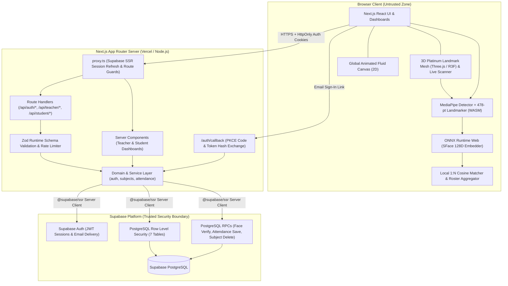
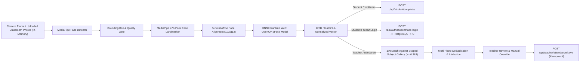
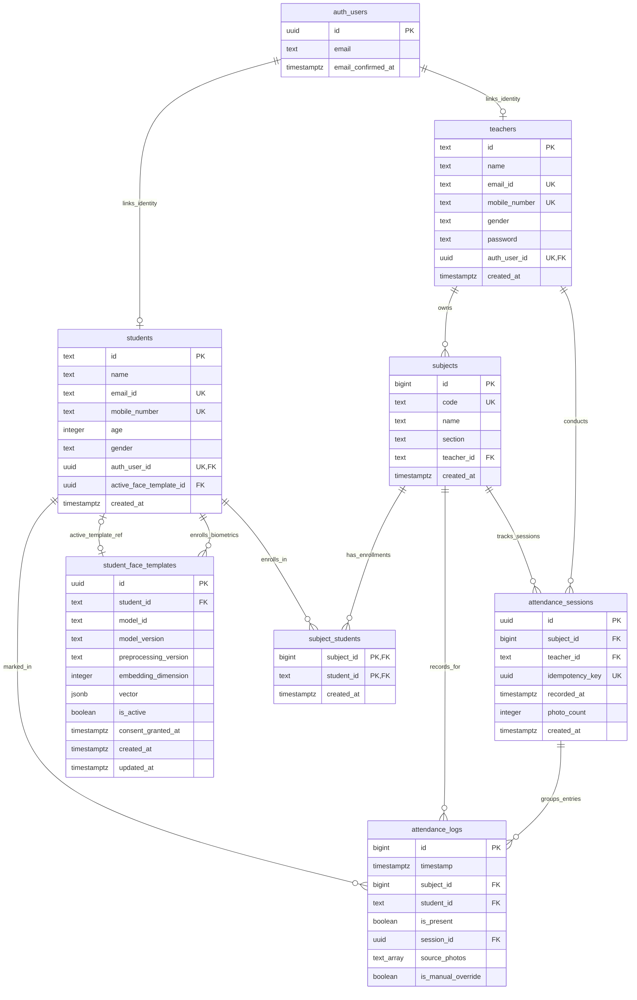

# Haziri.AI — AI-Powered Attendance Platform

<p align="left">
  
  
  
  
  
  
  
  
  
  
  
  
  <a href="./LICENSE">
    
  </a>
</p>

**Haziri.AI** is a privacy-first, AI-powered classroom attendance management platform built with **Next.js App Router**, **TypeScript**, **in-browser MediaPipe + OpenCV SFace 128D facial recognition**, and **Supabase PostgreSQL (Auth + Row Level Security)**.

All face detection, 478-point landmark alignment, and 128D embedding extraction run directly inside the browser (WebAssembly / ONNX Runtime Web) with zero raw classroom photo persistence on servers.

---

## Key Features

### Teacher Portal
- **Subject Management**: Create courses with normalized codes/sections, generate downloadable **QR Code & shareable join links**, and permanently **delete subjects** with cascading cleanup.
- **Multi-Photo Classroom Attendance**: Capture live frames or upload multiple classroom photos in-memory; detect and deduplicate recognized students across photos with source-photo attribution.
- **Human-in-the-Loop Verification**: Review matched vs. absent students, flag unknown faces, apply manual attendance overrides, discard safely without DB writes, or save with UUID idempotency protection.
- **Attendance Records & CSV Export**: Filter historical sessions by subject and date, inspect per-session student entries, and export clean CSV reports.

### Student Portal
- **Dual Authentication**: Sign in via Student ID / Email + Password, or **Passwordless FaceID Login** (browser 128D SFace probe verified inside PostgreSQL RPC → Supabase Auth one-time email Sign-In Link / OTP).
- **Biometric Template Enrollment**: Guided single-face capture with live MediaPipe landmark tracking and explicit consent storing versioned 128D SFace templates.
- **Course Enrollment**: Join subjects instantly via Teacher QR deep-link (`/?join-class=CODE`) or manual subject code, and unenroll anytime.
- **Attendance Analytics**: Track per-subject attendance percentages, overall metrics, and full attendance history.

### Interface & Visualization
- **Monochrome Platinum Spatial Glass UI**: Dark architectural design system (`#090A0B`, `#141719`, `#22272A`, `#B9D0D8`, `#91AAB4`, `#CDBF9D`, `#F5F6F6`, `#A0A9AC`).
- **3D Facial Landmark Mesh**: Interactive Three.js / React Three Fiber platinum mesh driven by live MediaPipe 478-point coordinates when the scanner is active.
- **Global Animated Fluid Canvas**: Hardware-composited 2D fluid background across all pages with pointer wake currents, visibility auto-pause, and `prefers-reduced-motion` support.

---

## Tech Stack

| Layer | Technology |
|---|---|
| **Framework** | Next.js 16 (App Router, Turbopack), React 19 |
| **Language** | TypeScript (strict mode) |
| **Styling & UI** | Tailwind CSS v4, Radix UI, shadcn-style primitives, Lucide React, Sonner |
| **3D & Animations** | Three.js, React Three Fiber, Drei, Framer Motion, HTML5 2D Fluid Canvas |
| **Face Detection & Landmarks** | `@mediapipe/tasks-vision` (MediaPipe Face Detector + 478-point Face Landmarker) |
| **Face Embeddings & Matching** | `onnxruntime-web` (OpenCV SFace 128D ONNX) + L2-normalized Cosine Similarity Matcher |
| **Forms & Validation** | React Hook Form, Zod |
| **Backend & Session Boundary** | Next.js Route Handlers, Server Components, `proxy.ts` (`@supabase/ssr`) |
| **Database & Auth** | Supabase PostgreSQL (Row Level Security + Transactional RPCs), Supabase Auth |
| **Utilities** | `qrcode` (QR enrollment PNG generation), `bcryptjs` (legacy compatibility) |
| **Testing & CI/CD** | Vitest, Playwright, ESLint, GitHub Actions, Vercel |

---

## System Design

> For complete sequence diagrams (FaceID Email Sign-In Link / OTP flow & Multi-Photo Classroom Attendance flow), see **[docs/ARCHITECTURE.md](docs/ARCHITECTURE.md)**.

### High-Level Architecture



### Browser Biometric Pipeline



---

## Database ER Diagram

> For the full PostgreSQL SQL DDL, indexes, Row Level Security rules, triggers, and RPC reference, see **[docs/DATABASE.md](docs/DATABASE.md)**.



---

## Documentation Reference

| Document | Contents |
|---|---|
| **[docs/ARCHITECTURE.md](docs/ARCHITECTURE.md)** | Complete Tech Stack & Mermaid System Design (High-Level Architecture, Biometric Pipeline, FaceID Auth Sequence, Multi-Photo Attendance & Subject Lifecycle Sequence) |
| **[docs/DATABASE.md](docs/DATABASE.md)** | Complete Database Schema (ER Diagram, PostgreSQL SQL DDL, Constraints, Indexes, Table Summary, RLS & RPC Functions) |

---

## Project Structure

```text
Haziri.AI/
├── web/                             # Next.js 16 App Router application (TypeScript strict)
│   ├── public/
│   │   ├── brand/                   # Haziri.AI Face Scanner SVG mark
│   │   └── models/                  # Browser-hosted MediaPipe & SFace ONNX model assets
│   ├── src/
│   │   ├── app/                     # App Router pages, layouts, and API Route Handlers
│   │   ├── components/              # UI primitives, 3D scene, biometric HUD, dashboards
│   │   ├── domain/                  # Pure domain logic (IDs, biometrics, attendance math)
│   │   ├── features/                # MediaPipe + SFace ONNX recognition engine & matcher
│   │   ├── lib/                     # Supabase SSR clients, Zod schemas, rate limiter, motion
│   │   ├── services/                # Server-only business services (auth, subjects, attendance)
│   │   └── types/                   # Typed Supabase PostgreSQL database contract
│   └── tests/                       # Vitest unit/security tests & Playwright E2E specs
├── supabase/
│   ├── migrations/                  # Incremental SQL migrations (schema, RLS, RPCs, cascade delete)
│   ├── staging_bootstrap.sql        # Combined idempotent bootstrap SQL for fresh Supabase projects
│   └── tests/                       # Multi-identity PostgreSQL RLS isolation test script
├── docs/
│   ├── ARCHITECTURE.md              # Tech Stack & System Design (Mermaid diagrams)
│   └── DATABASE.md                  # PostgreSQL Database Schema & ER Diagram
├── .github/workflows/
│   └── web-ci.yml                   # Automated lint, type-check, test, and production build CI
├── LICENSE                          # MIT License
└── README.md
```

---

## Local Setup

### 1. Prerequisites
- **Node.js 22+** and **npm**
- A **Supabase** project (PostgreSQL + Auth)

### 2. Database Initialization
Run `supabase/staging_bootstrap.sql` (or apply files in `supabase/migrations/` sequentially) in your **Supabase SQL Editor** to create tables, indexes, Row Level Security policies, triggers, and RPC functions.

*(Optional — for 6-digit OTP codes in addition to Sign-In Links during Student FaceID Login)*: In **Supabase Dashboard → Authentication → Email Templates → Magic Link**, include `{{ .Token }}` alongside the sign-in link (`{{ .SiteURL }}/auth/callback?token_hash={{ .TokenHash }}&type=email&next=/student/dashboard`).

### 3. Configure Environment Variables
Copy `.env.example` into `web/.env.local`:

```dotenv
NEXT_PUBLIC_SUPABASE_URL=https://<your-project-ref>.supabase.co
NEXT_PUBLIC_SUPABASE_PUBLISHABLE_KEY=<your-supabase-publishable-key>
NEXT_PUBLIC_SITE_URL=http://localhost:3000
```

> **Security Note**: Never expose `SUPABASE_SERVICE_ROLE_KEY` in client code or `NEXT_PUBLIC_*` variables. Haziri.AI operates with zero service-role key usage by enforcing Supabase Auth + PostgreSQL RLS and narrow RPCs.

### 4. Install & Run

```bash
cd web
npm install
npm run dev
```

Open [http://localhost:3000](http://localhost:3000).

---

## Verification & Quality Commands

Run from `web/`:

```bash
npm run lint        # ESLint
npm run type-check  # TypeScript strict check (tsc --noEmit)
npm run test        # Vitest unit & API security boundary tests
npm run build       # Next.js production build
npm run test:e2e    # Playwright desktop & mobile E2E tests
```

---

## Security & Privacy Model

- **Zero Raw Biometric Photo Persistence**: Classroom attendance photos stay strictly in browser memory and are cleared immediately after save or discard.
- **Model-Versioned Templates**: Only mathematical 128D SFace embedding vectors (`student_face_templates`) are stored with explicit student consent timestamps.
- **Server & Database Trust Boundary**: All browser inputs, IDs, and match claims are treated as untrusted; authorization is enforced on Next.js server boundaries and PostgreSQL Row Level Security across all 7 tables.
- **Zero Service-Role Exposure**: Registration conflict checks, identifier resolution, face-login cosine matching, idempotent attendance writes, and cascading subject deletion run through least-privilege PostgreSQL RPCs and RLS policies.

---

## License

This project is licensed under the **MIT License** — see the [LICENSE](./LICENSE) file for details.

---

<p align="center">
  Made with ❤️ by <strong>Alok Prasad</strong>
</p>
