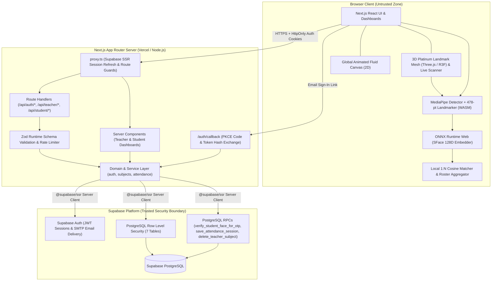
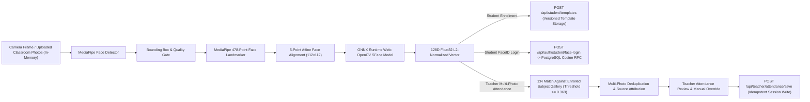
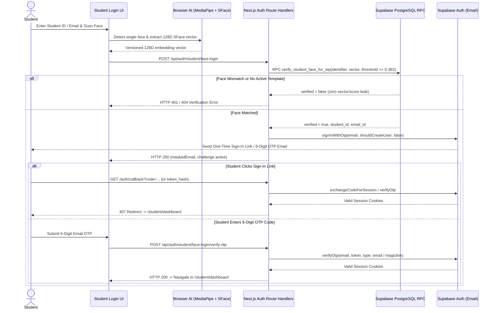

# Haziri.AI — Architecture & System Design

## Tech Stack

| Layer | Technology |
|---|---|
| Framework | Next.js 16 (App Router, Turbopack, React 19) |
| Language | TypeScript (strict mode) |
| Styling & UI | Tailwind CSS v4, Radix UI, shadcn-style primitives, Lucide React, Sonner |
| 3D Visualization & Motion | Three.js, React Three Fiber, Drei, Framer Motion, HTML5 2D Animated Fluid Canvas |
| Browser Face Detection & Landmarks | `@mediapipe/tasks-vision` (MediaPipe Face Detector + 478-point Face Landmarker) |
| Browser Face Embeddings & Matching | `onnxruntime-web` (OpenCV SFace 128D ONNX) + L2-normalized Cosine Similarity Matcher |
| Forms & Runtime Validation | React Hook Form, Zod |
| Backend & Session Boundary | Next.js Route Handlers, Server Components, `proxy.ts` (`@supabase/ssr`) |
| Database & Security | Supabase PostgreSQL with Row Level Security (RLS) and Transactional RPCs |
| Authentication | Supabase Auth (Email/Password + Face-Verified Email Sign-In Link / OTP) |
| QR Enrollment | `qrcode` (client-side QR PNG generation & deep-link continuation) |
| Testing & CI/CD | Vitest, Playwright, ESLint, GitHub Actions, Vercel |

---

## System Design

### 1. High-Level System Architecture

---

### 2. Browser Biometric Face Recognition Pipeline

---

### 3. Student FaceID Login & Email Verification Flow

---

### 4. Multi-Photo Classroom Attendance & Subject Management Flow

```mermaid
sequenceDiagram
    actor Teacher
    participant UI as Teacher Dashboard UI
    participant AI as Browser AI Engine
    participant API as Next.js Teacher API
    participant DB as Supabase PostgreSQL (RLS + RPC)

    rect rgb(20, 23, 25)
        Note over Teacher,DB: Subject Lifecycle (Create, Share QR, Delete)
        Teacher->>UI: Create Subject (code, name, section)
        UI->>API: POST /api/teacher/subjects
        API->>DB: INSERT public.subjects (RLS teacher_id check)
        DB-->>UI: Created Subject + QR Join Link

        Teacher->>UI: Confirm Delete Subject
        UI->>API: DELETE /api/teacher/subjects
        API->>DB: DELETE public.subjects (ON DELETE CASCADE / delete_teacher_subject RPC)
        DB-->>UI: Deleted Subject + Cascade Cleanup
    end

    rect rgb(20, 23, 25)
        Note over Teacher,DB: Multi-Photo Attendance Session
        Teacher->>UI: Select Owned Subject
        UI->>API: GET /api/teacher/attendance/roster?subjectId=...
        API->>DB: Load Enrolled Students & Active SFace Templates (RLS)
        DB-->>UI: Scoped Subject Gallery
        Teacher->>UI: Capture / Upload Multiple Classroom Photos
        UI->>AI: Detect & Match All Faces Across Photos (In-Memory)
        AI-->>UI: Deduplicated Present/Absent Table + Source Photo Labels
        Teacher->>UI: Apply Manual Overrides & Click Confirm Save
        UI->>API: POST /api/teacher/attendance/save (with UUID idempotencyKey)
        API->>DB: RPC save_attendance_session (Transactional, RLS Enforced)
        DB-->>UI: session_id, inserted_count, deduplicated flag
        UI-->>Teacher: Clear In-Memory Photos & Show Confirmation
    end
```

