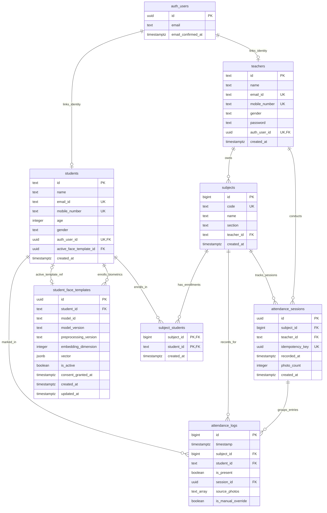

# Haziri.AI — Database Schema

PostgreSQL relational schema hosted on Supabase (`public` schema linked to `auth.users`).

---

## Entity Relationship Diagram



---

## SQL Schema Definition

```sql
-- 1. Teachers
CREATE TABLE public.teachers (
  id text NOT NULL,
  name text NOT NULL,
  email_id text NOT NULL UNIQUE,
  mobile_number text NOT NULL UNIQUE,
  gender text NOT NULL,
  password text NOT NULL,
  auth_user_id uuid UNIQUE REFERENCES auth.users(id) ON DELETE SET NULL,
  created_at timestamptz DEFAULT now(),
  CONSTRAINT teachers_pkey PRIMARY KEY (id)
);

-- 2. Students
CREATE TABLE public.students (
  id text NOT NULL,
  name text NOT NULL,
  email_id text NOT NULL UNIQUE,
  mobile_number text NOT NULL UNIQUE,
  age integer NOT NULL,
  gender text NOT NULL,
  auth_user_id uuid UNIQUE REFERENCES auth.users(id) ON DELETE SET NULL,
  active_face_template_id uuid,
  created_at timestamptz DEFAULT now(),
  CONSTRAINT students_pkey PRIMARY KEY (id)
);

-- 3. Versioned Biometric Face Templates (128D SFace ONNX)
CREATE TABLE public.student_face_templates (
  id uuid PRIMARY KEY DEFAULT gen_random_uuid(),
  student_id text NOT NULL REFERENCES public.students(id) ON DELETE CASCADE,
  model_id text NOT NULL,
  model_version text NOT NULL,
  preprocessing_version text NOT NULL,
  embedding_dimension integer NOT NULL CHECK (embedding_dimension > 0),
  vector jsonb NOT NULL,
  is_active boolean NOT NULL DEFAULT true,
  consent_granted_at timestamptz NOT NULL DEFAULT now(),
  created_at timestamptz NOT NULL DEFAULT now(),
  updated_at timestamptz NOT NULL DEFAULT now(),
  CONSTRAINT student_face_templates_vector_is_array CHECK (jsonb_typeof(vector) = 'array'),
  CONSTRAINT student_face_templates_vector_len_matches CHECK (jsonb_array_length(vector) = embedding_dimension)
);

ALTER TABLE public.students
  ADD CONSTRAINT students_active_face_template_id_fkey
  FOREIGN KEY (active_face_template_id)
  REFERENCES public.student_face_templates(id)
  ON DELETE SET NULL;

-- 4. Subjects
CREATE TABLE public.subjects (
  id bigint GENERATED ALWAYS AS IDENTITY NOT NULL,
  code text NOT NULL UNIQUE,
  name text NOT NULL DEFAULT 'unknown'::text,
  section text NOT NULL DEFAULT 'N/A'::text,
  teacher_id text REFERENCES public.teachers(id) ON DELETE SET NULL,
  created_at timestamptz DEFAULT now(),
  CONSTRAINT subjects_pkey PRIMARY KEY (id)
);

-- 5. Subject-Student Enrollments (Many-to-Many)
CREATE TABLE public.subject_students (
  subject_id bigint NOT NULL REFERENCES public.subjects(id) ON DELETE CASCADE,
  student_id text NOT NULL REFERENCES public.students(id) ON DELETE CASCADE,
  created_at timestamptz DEFAULT now(),
  CONSTRAINT subject_students_pkey PRIMARY KEY (subject_id, student_id)
);

-- 6. Attendance Sessions (Idempotent Session Headers)
CREATE TABLE public.attendance_sessions (
  id uuid PRIMARY KEY DEFAULT gen_random_uuid(),
  subject_id bigint NOT NULL REFERENCES public.subjects(id) ON DELETE CASCADE,
  teacher_id text NOT NULL REFERENCES public.teachers(id) ON DELETE RESTRICT,
  idempotency_key uuid NOT NULL UNIQUE,
  recorded_at timestamptz NOT NULL DEFAULT now(),
  photo_count integer NOT NULL DEFAULT 0 CHECK (photo_count >= 0),
  created_at timestamptz NOT NULL DEFAULT now()
);

-- 7. Attendance Logs (Per-Student Entries)
CREATE TABLE public.attendance_logs (
  id bigint GENERATED ALWAYS AS IDENTITY NOT NULL,
  "timestamp" timestamptz DEFAULT now(),
  subject_id bigint REFERENCES public.subjects(id) ON DELETE CASCADE,
  student_id text REFERENCES public.students(id) ON DELETE CASCADE,
  is_present boolean DEFAULT true,
  session_id uuid REFERENCES public.attendance_sessions(id) ON DELETE SET NULL,
  source_photos text[] NOT NULL DEFAULT '{}'::text[],
  is_manual_override boolean NOT NULL DEFAULT false,
  CONSTRAINT attendance_logs_pkey PRIMARY KEY (id)
);

-- Indexes
CREATE UNIQUE INDEX student_face_templates_one_active_per_model_idx
  ON public.student_face_templates (student_id, model_id)
  WHERE is_active = true;

CREATE INDEX student_face_templates_student_active_idx
  ON public.student_face_templates (student_id)
  WHERE is_active = true;

CREATE INDEX students_active_face_template_id_idx
  ON public.students (active_face_template_id)
  WHERE active_face_template_id IS NOT NULL;

CREATE INDEX subjects_teacher_id_idx
  ON public.subjects (teacher_id);

CREATE INDEX subject_students_student_id_idx
  ON public.subject_students (student_id);

CREATE INDEX attendance_sessions_subject_idx
  ON public.attendance_sessions (subject_id, recorded_at DESC);

CREATE INDEX attendance_sessions_teacher_idx
  ON public.attendance_sessions (teacher_id, recorded_at DESC);

CREATE UNIQUE INDEX attendance_logs_session_student_unique_idx
  ON public.attendance_logs (session_id, student_id)
  WHERE session_id IS NOT NULL;

CREATE INDEX attendance_logs_subject_ts_idx
  ON public.attendance_logs (subject_id, "timestamp" DESC);

CREATE INDEX attendance_logs_student_ts_idx
  ON public.attendance_logs (student_id, "timestamp" DESC);
```

---

## Tables Summary

| Table | Primary Key | Row Level Security | Purpose |
|---|---|---|---|
| `public.teachers` | `id` (`T####`) | Enabled (self-only; `password` column SELECT revoked) | Teacher identity and Supabase Auth mapping |
| `public.students` | `id` (`S####`) | Enabled (self + owning teachers of enrolled subjects) | Student profile, Auth mapping, and active face template pointer |
| `public.student_face_templates` | `id` (`uuid`) | Enabled (self + active templates for enrolled subject teachers) | Model-versioned 128D SFace biometric vectors with consent timestamps |
| `public.subjects` | `id` (`bigint`) | Enabled (owner teacher full CRUD; enrolled students SELECT) | Teacher-owned courses with unique join `code` |
| `public.subject_students` | `(subject_id, student_id)` | Enabled (student own enroll/unenroll; teacher SELECT owned subjects) | Many-to-many student course enrollment |
| `public.attendance_sessions` | `id` (`uuid`) | Enabled (owner teacher SELECT/INSERT; enrolled students SELECT) | Idempotent attendance session headers (`idempotency_key`) |
| `public.attendance_logs` | `id` (`bigint`) | Enabled (owner teacher SELECT/INSERT; student own SELECT) | Per-student attendance status, source photos, and manual override audit |

---

## Database Functions & Triggers

| Object | Kind | Role / Access | Responsibility |
|---|---|---|---|
| `handle_new_auth_user()` / `on_auth_user_created` | Trigger (`AFTER INSERT` on `auth.users`) | `SECURITY DEFINER` | Auto-provisions `teachers` or `students` row (and optional `join_class_code` enrollment) on signup |
| `sync_student_active_face_template()` / `on_student_face_template_change` | Trigger (`AFTER INSERT/UPDATE/DELETE`) | `SECURITY DEFINER` | Synchronizes `students.active_face_template_id` with latest active template |
| `check_registration_conflicts(...)` | RPC | `anon`, `authenticated` | Checks duplicate ID, email, or mobile without exposing profile PII |
| `resolve_login_identifier(...)` | RPC | `anon`, `authenticated` | Resolves `T####` / `S####` or email to login email and link status |
| `verify_legacy_teacher_password(...)` | RPC | `anon`, `authenticated` | Verifies legacy bcrypt password hashes strictly inside PostgreSQL |
| `claim_legacy_profile(...)` | RPC | `authenticated` | Links email-confirmed Supabase Auth user to an unlinked legacy profile |
| `lookup_subject_by_code(...)` | RPC | `authenticated` | Returns minimal subject metadata (`id`, `code`, `name`, `section`) for join flows |
| `verify_student_face_for_otp(...)` | RPC | `anon`, `authenticated` | Computes 128D cosine similarity (`>= 0.363`) inside PostgreSQL without exposing stored vectors |
| `save_attendance_session(...)` | RPC | `authenticated` (`SECURITY INVOKER`) | Atomically creates idempotent `attendance_sessions` + `attendance_logs` under RLS |
| `delete_teacher_subject(...)` | RPC | `authenticated` (`SECURITY DEFINER`) | Ownership-verified cascading deletion of a teacher's subject, enrollments, sessions, and logs |
